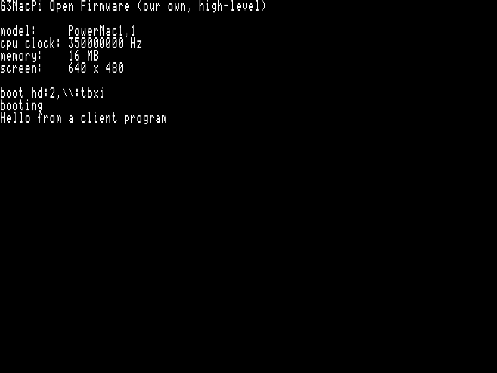

# 2026-11-18 — The Blue & White device tree

- Read Linux's PowerMac support for what it needs from the B&W's device
  tree (facts only): the model, node names, `compatible` strings,
  `assigned-addresses`, `ranges`, the NewWorld `interrupt-controller`
  test, one-cell interrupts, and the IDE register and DMA limits.
- `build_bw_device_tree` builds the tree from the machine's
  configuration. Every value's source is in `bw-device-tree.md`; values
  only a real B&W would show are "to verify".
- Tests translate every mac-io cell's address the way Linux does and
  compare it with the emulator's hardware constants.
- Sabotage: 9 mutations. One first survived (a fixed BAR in
  `assigned-addresses`), and a check was added. All are caught now.
- 219/219 tests pass.

## Same day: the machine boots from a disk image

- `BwFirmware` does power-on for the B&W: it assigns PCI resources, lays
  out firmware memory, builds the device tree, binds the disks and the
  console, and installs the client interface.
- End-to-end test: `boot hd:2,\\:tbxi` runs a bootinfo script from an
  HFS+ disk image. The script loads a fragmented ELF program, and the
  program runs on the emulated CPU. It finds `/chosen`, reads `stdout`
  and prints "Hello from a client program" through the console.
- It passed on the first run, so I checked it with sabotage: removing
  any one power-on step breaks it.
- `YosemiteMachine` now exposes its RAM size and clocks.
- 222/222 tests pass.

## Same day: the display (steps 3a and 3b)

- Display device of our own (not PCI, so no borrowed vendor ID): video
  memory as RAM, a register block with mode staging + APPLY, a palette,
  and depths 8/15/32, the values Linux offb uses.
- In the machine at 0x90000000/0x91000000. The firmware sets a power-on
  mode, adds a `display` node with offb's properties, and provides the
  `color!`, `color@`, `set-colors`, `fill-rectangle` and `dimensions`
  methods.
- Sabotage: 13 mutations across both. One first survived (a wrong
  15-bit shift that pure red can't reveal); a mid-range colour test was
  added. 228/228 tests pass.
- Next: 3c, text on the screen (a font of our own and a terminal), then
  3d, our Mac OS display driver.

## Same day: text on the screen (step 3c)

- Our own 8×8 font (95 glyphs, drawn as ASCII art in
  `tools/font/make_font.py`, which generates the table), drawn at 8×16.
- The display's `write` is a text terminal: wrap, scroll and control
  characters. When there's a display, `/chosen stdout` is the screen, with
  the text echoed to the boot log.
- Sabotage: 9 mutations, all caught. 231/231 tests pass.

## First picture

Real emulator output (the framebuffer, scaled 2×). Our firmware prints a
banner and facts read from the device tree through Forth (model, CPU
clock, memory, screen size). It then boots the test disk image:
- `boot hd:2,\\:tbxi` runs the bootinfo script, which prints "booting";
- the script loads the ELF test client;
- the client prints through the client interface while running on the
  emulated 750.

Produced by a small throwaway program linked against the core library;
the same flow is covered by `tests/unit/machine/test_bw_boot.cpp` and
`test_bw_display.cpp`.
